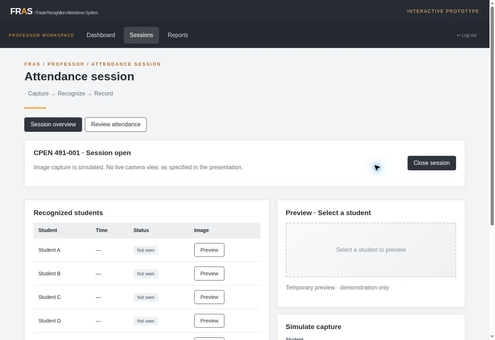

# FRAS — Facial Recognition Attendance System

**Interactive interface prototype for professor and administrator attendance workflows.**  
Collaborative academic project by **Miguel A. De Jesus** and **Ricardo J. Lopez Ortiz** · CPEN 491 · Universidad Ana G. Méndez, Gurabo.

[Open the prototype](https://pologram1.github.io/FRAS-Demo/) · [Project context](https://pologram1.github.io/POLO-TECH/projects.html#fras)

[](https://github.com/pologram1/FRAS-Demo/actions/workflows/validate.yml)



## What to explore

FRAS demonstrates the interface from the senior-design presentation, including professor sessions and administrator management. It lets reviewers walk through attendance decisions without camera hardware or a university database.

- **Professor:** assigned sections, open/close a session, simulate recognition, flag uncertain results, review and correct attendance, and export reports.
- **Administrator:** dashboard, simulated facial enrollment, course synchronization, user-account management, and backup snapshots.
- **Reports:** CSV download and browser print/PDF output.

## Try the workflow

1. Open the prototype, choose **Professor**, and press **Log in**. Credentials are not validated.
2. Start a session for the active section.
3. Use **Recognize** or **Flag low confidence** to simulate a result.
4. Open **Review attendance** inside Sessions and confirm, reject, or correct a record.
5. Close the session and explore Reports.
6. Log out and choose **Administrator** to inspect its management screens.

All people/courses are fictional. Capture, recognition, reference images, enrollment, synchronization, accounts, and backups are simulated. There is **no real facial recognition, live camera, biometric storage, university integration, or secure authentication**. Runtime changes are held in page memory and reset on reload; downloaded report/backup files are independent exports.

## Architecture and code map

| Path | Responsibility |
| --- | --- |
| `index.html` | Login, navigation, and the content shell. |
| `css/styles.css` | Responsive presentation and shared components. |
| `js/app.js` | Fictional records, state, rendering, and client-side actions. |
| `docs/ARCHITECTURE.md` | Detailed code structure and workflow guide. |
| `scripts/check-static.mjs` | Checks the entry page, local assets, and JavaScript syntax without executing the app. |
| `.github/workflows/validate.yml` | Runs static prototype checks on pushes and pull requests. |
| `docs/images/preview.jpg` | Screenshot of the deployed prototype. |

The prototype uses browser-side state and DOM rendering. It is deliberately independent of the eventual recognition pipeline, database, and hardware selection. HTML, CSS, and JavaScript are separated for readability. See the [architecture guide](docs/ARCHITECTURE.md) to follow the current workflows.

## Run locally

```sh
git clone https://github.com/pologram1/FRAS-Demo.git
cd FRAS-Demo
python3 -m http.server 8000
```

Open `http://localhost:8000`. No dependency installation or backend is required.

## Validation

With Node.js 22:

```sh
node scripts/check-static.mjs
```

The automated check covers the HTML entry point, local stylesheet/script references, and JavaScript syntax. It does not measure recognition accuracy or certify end-to-end attendance behavior. For a manual check, follow the professor workflow above and inspect the administrator screens.

## Collaboration and status

**Miguel A. De Jesus and Ricardo J. Lopez Ortiz** are the academic project collaborators. Shared project scope includes requirements/design work and the professor/administrator workflow represented by this prototype; no individual ownership of a specific subsystem is asserted here.

**Status: simulated interface prototype · System in development.** Future implementation includes selecting hardware/software, developing recognition and storage, validating consent/privacy controls, and testing with authorized institutional requirements. Design targets are not measured results.

[Portfolio](https://pologram1.github.io/POLO-TECH/) · [Contact Miguel](mailto:themiguel10101@gmail.com)
